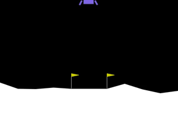
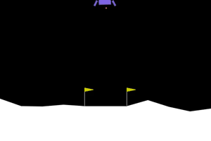
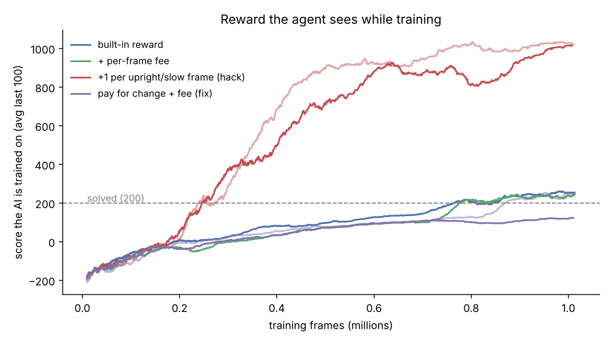
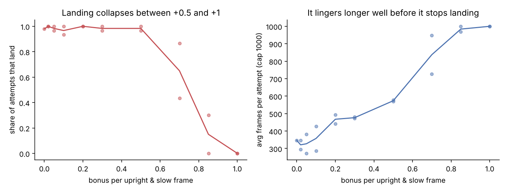

# lunar lander + reward hacking

Trained PPO to land the rocket in Gymnasium's LunarLander-v3, then messed with the reward to see if I could make it cheat. It cheated.

<p>


</p>

Left: normal reward, lands fine. Right: I added +1 for every frame the rocket is upright and moving slowly. Sounds harmless, but hovering for 1000 frames pays way more than landing, so it just parks above the pad until the episode times out.

## results

Every model is scored on the normal game with my extra reward turned off, so the numbers are comparable. 1M training steps each, Stable-Baselines3 PPO, about 5 min per run on CPU.

| reward | score | landed |
|---|---|---|
| built-in | 257 | 49/50 |
| built-in + small cost per frame | 267 | 50/50, and ~15% faster |
| +1 per upright/slow frame | -89 and -64 (2 seeds) | 0/40 |
| fixed version | 264 and 271 (2 seeds) | 99/100 |

The fix pays for *becoming* upright and slow (the change from one frame to the next) instead of for *being* upright and slow. Over a whole episode that adds up to at most +1, so there's nothing to farm. I kept the per-frame cost too so waiting around isn't free.



This is the part I thought was funniest. The hacked agent's training score goes up to ~1000 while it literally never lands once.

## how big does the bonus have to be?

I swept the hover bonus from 0.02 up to 1.0 per frame, 2 seeds each.



It keeps landing up to about +0.5, but it starts hanging around way before that (at +0.2 landings already take ~40% longer). Somewhere between +0.7 and +1.0 it gives up on landing completely. At +0.7 the two seeds landed 43% and 87% of the time, so right at the edge it basically depends on luck during training.

Raw numbers for every run are in `results/`.

## run it

```
pip install swig
pip install "gymnasium[box2d]" stable-baselines3 imageio imageio-ffmpeg pandas matplotlib
python train.py baseline          # or timefee, hover, fix, hover:0.5
python evaluate.py baseline_s0    # scores on the normal game and saves a clip
```

`rewards.py` has all the reward versions.
